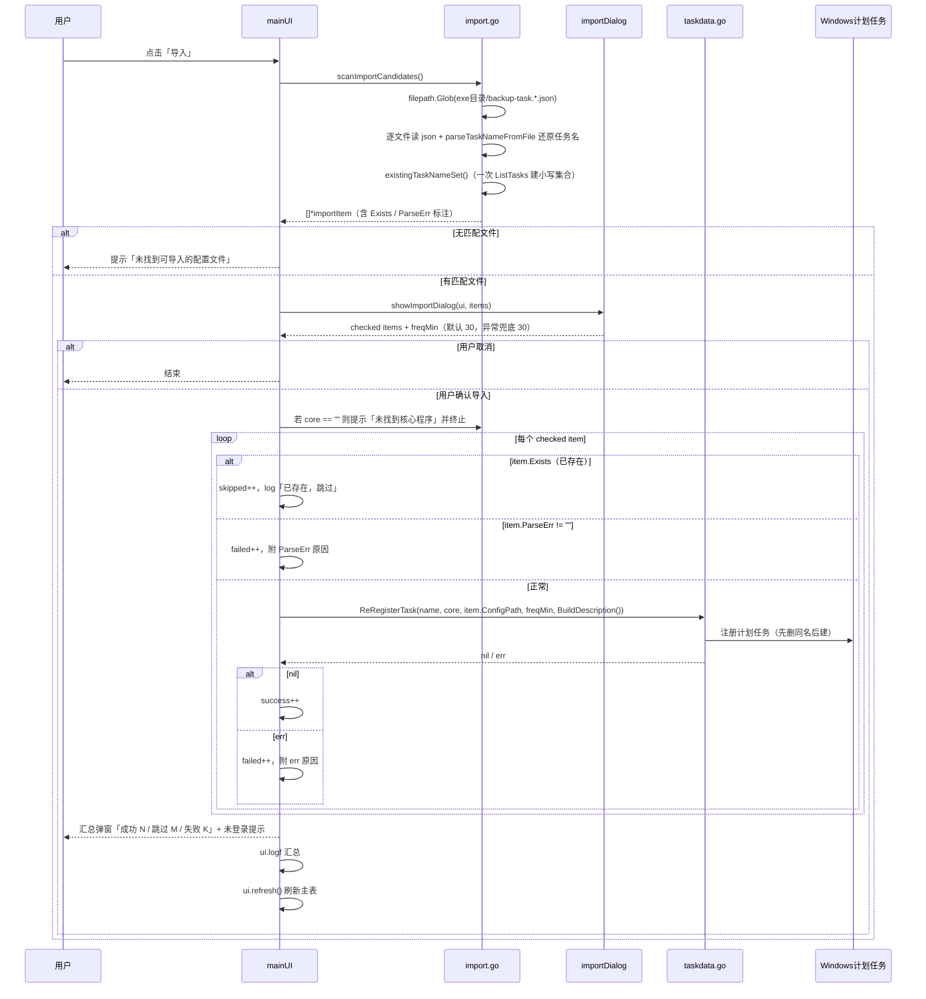
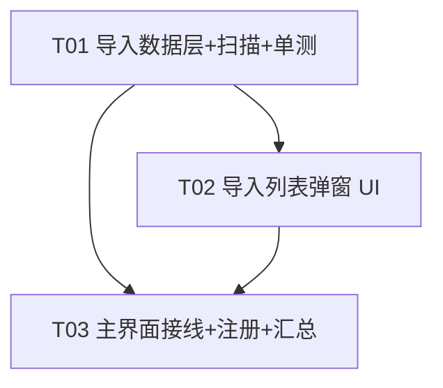

# BaiduPCS-Backup v1.1.0「导入」功能 — 增量系统设计

> 架构师：高见远（Bob）
> 范围：仅 v1.1.0 变更部分（导入功能），核心侧 `BaiduPCS-Go/` 本次不改动。

---

## Part A：系统设计

### 1. 实现方案

#### 1.1 核心难点分析

| 难点 | 分析 | 方案 |
|------|------|------|
| 反向解析任务名 | 文件名 `backup-task.<任务名>.json`，`sanitizePath` 只把 `:` `/` `\` 替换为 `-`，逆操作无法可靠还原（`-` 无法区分原名/替换符） | 本项目任务名约定为 `n-backup`，本就不含 `:` `/` `\`，故 `sanitizePath` 对任务名是恒等变换。直接 `TrimPrefix("backup-task.")` + `TrimSuffix(".json")` 还原，无需逆 sanitize |
| 判重 | 若对 N 个候选逐个调 `TaskExists(name)`，会产生 N 次 `ListTasks()`（N 次 PowerShell 调用，慢且易超时） | 一次 `ListTasks()` 建立小写任务名集合 `map[string]bool`，O(1) 判重 |
| 已存在→跳过（不覆盖） | `ReRegisterTask` 内部「先删同名再重建」，若对已存在项调用会覆盖原任务 | 注册前先判重，已存在项走「跳过」分支，**绝不**落入 `ReRegisterTask` |
| 频率枚举 | 需求为细粒度枚举（每 5/10/15/30 分、每 1/2/4/6/12 时、每天），与 edit.go 的 `freqPresets`（含每周/自定义）不一致 | 新建独立 `importFreqPresets`，不复用 edit.go 的下拉 |
| 勾选列表 UI | 需批量勾选 + 默认勾选规则 | 用 walk `TableView` 原生复选框（`SetCheckBoxes(true)` + 模型实现 `walk.ItemChecker`） |
| 配置路径指向 | 导入不应重写/迁移配置，任务应指向被扫描到的原始文件 | 注册时直接传 `importItem.ConfigPath`（扫描文件的绝对路径），不走 `NewTaskConfigPath()` |

#### 1.2 框架与库选择

- 沿用 **lxn/walk**（GUI）+ **golang.org/x/text**（GBK 解码，仅既有代码用）+ **标准库**（`encoding/json` / `os` / `path/filepath` / `strings`）。
- **无新增依赖**。不引入新框架，保持与现有「单 package main + 每对话框一文件」的轻量结构一致。
- 架构模式：延续现有的「数据逻辑 + 对话框 + 主界面接线」分层，新增 `import.go`（纯逻辑，可单测）与 `import_dialog.go`（UI），主界面只做接线与汇总。

---

### 2. 文件列表

| 相对路径 | 操作 | 职责 |
|----------|------|------|
| `BaiduPCS-Backup-GUI-Lite/import.go` | **新增** | 导入数据模型 `importItem`、频率枚举 `importFreqPresets`、扫描 `scanImportCandidates`、反向解析 `parseTaskNameFromFile`、判重集合 `existingTaskNameSet`、注册辅助 `registerImportItem` |
| `BaiduPCS-Backup-GUI-Lite/import_dialog.go` | **新增** | 导入列表弹窗 `importDialog` + `importTableModel`（TableView 勾选列表 + 频率下拉 + 确定/取消） |
| `BaiduPCS-Backup-GUI-Lite/main.go` | **修改** | row2 增加「导入」按钮 + 事件 `ui.importTasks` + 结果汇总 + 刷新主表 |
| `BaiduPCS-Backup-GUI-Lite/import_test.go` | **新增** | 反向解析 / 扫描 / 频率兜底 单元测试（纯逻辑，不依赖 walk） |

> 核心侧 `BaiduPCS-Go/` **无改动**；`taskdata.go` 无需改动（`ReRegisterTask` / `ResolveCoreExe` / `BuildDescription` / `ListTasks` 全部复用）。

---

### 3. 数据结构与接口

#### 3.1 类图

```mermaid
classDiagram
    class importItem {
        +string FileName
        +string Name
        +string ConfigPath
        +string LocalDir
        +string RemoteDir
        +bool Exists
        +string ParseErr
    }
    class importFreqPreset {
        +string text
        +int minutes
    }
    class importTableModel {
        -[]*importItem items
        -map[int]bool checked
        +RowCount() int
        +Value(row, col int) interface{}
        +Checked(index int) bool
        +SetChecked(index int, checked bool) error
    }
    class importDialog {
        -*walk.Dialog
        -[]*importItem items
        -*importTableModel model
        -*walk.TableView table
        -*walk.ComboBox freqCb
        -bool accepted
        -int freqMin
        +run() []*importItem, int, bool
    }
    importDialog --> importTableModel : 持有
    importTableModel --> importItem : 持有
```

#### 3.2 关键结构与函数签名

```go
// ===== import.go（纯逻辑层，可单测）=====

const (
    importCfgPrefix  = "backup-task."   // 文件名前缀
    importCfgSuffix  = ".json"          // 文件名后缀
    defaultImportFreqMin = 30           // 频率兜底默认：每 30 分钟
)

// importItem 导入列表中的一行（一个可导入的配置文件）
type importItem struct {
    FileName   string // 文件名，如 backup-task.1-backup.json
    Name       string // 反向解析出的任务名，如 1-backup（空=无法解析）
    ConfigPath string // 配置文件的绝对路径（注册时直接指向它，不重写/迁移）
    LocalDir   string // 配置内 local_dir（列表摘要展示）
    RemoteDir  string // 配置内 remote_dir（列表摘要展示）
    Exists     bool   // 计划任务中是否已存在同名（已存在默认不勾选）
    ParseErr   string // 解析失败原因；空=正常
}

// importFreqPresets 导入专用频率枚举（细粒度，与 edit.go 的 freqPresets 不同，无每周/自定义）
var importFreqPresets = []importFreqPreset{
    {"每5分钟", 5}, {"每10分钟", 10}, {"每15分钟", 15}, {"每30分钟", 30},
    {"每1小时", 60}, {"每2小时", 120}, {"每4小时", 240},
    {"每6小时", 360}, {"每12小时", 720}, {"每天", 1440},
}

// parseTaskNameFromFile 从文件名还原任务名：backup-task.<name>.json -> <name>
func parseTaskNameFromFile(fileName string) string

// scanImportCandidates 扫描 GUI 所在目录（exe 目录，与 gui_config.json/mode_config.json 同级）
// 下所有 backup-task.*.json，逐文件解析并标注 Exists / ParseErr。
func scanImportCandidates() ([]*importItem, error)

// existingTaskNameSet 一次性查询计划任务名集合（统一转小写），避免逐条 TaskExists 的 O(N) 次 PS 调用
func existingTaskNameSet() (map[string]bool, error)

// registerImportItem 注册单个导入项；返回错误即失败原因。
// 前置条件：调用方已确认 !it.Exists && it.ParseErr == ""。
func registerImportItem(it *importItem, freqMin int, coreExe string) error

// ===== import_dialog.go（UI 层）=====

// showImportDialog 弹出导入列表弹窗。
// 返回：(勾选的 items, 选择的频率分钟, 是否确认)。
// 频率未选择/异常时回退 defaultImportFreqMin。
func showImportDialog(owner walk.Form, items []*importItem) (checked []*importItem, freqMin int, ok bool)

// ===== main.go（修改）=====

// importTasks 「导入」按钮事件：扫描 -> 弹窗 -> 逐个注册 -> 汇总 -> 刷新主表
func (ui *mainUI) importTasks()
```

#### 3.3 表模型（勾选列实现要点，已核实 walk 版本 API）

- `importTableModel` 内嵌 `walk.TableModelBase`，并额外实现 `walk.ItemChecker`：
  - `Checked(index int) bool` — 返回 `m.checked[index]`
  - `SetChecked(index int, checked bool) error` — 写 `m.checked[index]` 并 `PublishRowChanged(index)`
- 表 `TableView.SetCheckBoxes(true)` 开启原生复选框（LVS_EX_CHECKBOXES，勾选框落在第一列）。
- 默认勾选规则：`checked[i] = !item.Exists && item.ParseErr == ""`（已存在 / 解析失败默认不勾选）。
- 列定义（Value 列序）：`0 文件名`、`1 任务名`、`2 源(local_dir)`、`3 目标(remote_dir)`、`4 状态`。
  状态列文案：`已存在` / `解析失败:<原因>` / `可导入`。

---

### 4. 程序调用流程（时序图）



---

### 5. Anything UNCLEAR（待明确事项 / 假设）

1. **「应用到所有勾选项」** 理解为：弹窗内仅一个全局频率下拉（非每行一个），确认时把该频率统一应用到所有勾选项。若产品意图是「每行独立频率」，需在 P2 追加，本次不做。
2. **已存在判定口径**：仅计划任务层面（`TaskExists` 等价语义，大小写不敏感）。不查配置文件层面（文件本身就在磁盘，导入即指向它）。
3. **配置路径**：导入注册指向扫描到的原始文件绝对路径，不重写、不迁移、不改名。`log_dir`/`exclude`/`max_retry` 等字段原样保留，交由核心侧 `normalize()` 兜底。
4. **扫描目录**：严格按 PRD 用 exe 目录（`filepath.Dir(os.Executable())`），与 `gui_config.json`/`mode_config.json` 同级；**不用** `TaskConfigDir()`（它优先返回已有任务的配置目录，与「重装/换电脑后配置文件仍在 GUI 目录」场景不符）。
5. **未登录提示**：P0 不做登录校验，仅在汇总时静态附带「若网盘未登录，导入的任务执行时将失败」。若后续要做条件提示，可在 P1 用 `VerifyLogin` 判定后仅在未登录时提示。
6. **解析失败判定**（P1）：`json.Unmarshal` 失败，或 `local_dir` 为空，标记 `ParseErr`；该文件不阻断其它文件。
7. **同名文件名的空任务名**（如 `backup-task..json`）标 `ParseErr`「文件名无法解析任务名」，默认不勾选。

---

## Part B：任务分解

### 6. 依赖包

- **无新增依赖**。
- 现有依赖确认够用：`github.com/lxn/walk v0.0.0-20210112085537`（TableView/ComboBox/Dialog）、`github.com/lxn/win`（间接）、`golang.org/x/text`（既有 GBK 解码）。`os`/`path/filepath`/`encoding/json`/`strings` 均为标准库。

### 7. 任务列表（按实现顺序）

| Task ID | 任务名 | 源文件 | 依赖 | 优先级 |
|---------|--------|--------|------|--------|
| **T01** | 导入数据层 + 扫描 + 单测 | `import.go`（新增）、`import_test.go`（新增） | 无 | P0 |
| **T02** | 导入列表弹窗 UI | `import_dialog.go`（新增） | T01 | P0 |
| **T03** | 主界面接线 + 注册 + 汇总刷新 | `main.go`（修改） | T01、T02 | P0 |

**T01 — 导入数据层 + 扫描 + 单测**
- 实现 `importItem`、`importFreqPreset`/`importFreqPresets`、`parseTaskNameFromFile`、`scanImportCandidates`、`existingTaskNameSet`、`registerImportItem`。
- 扫描规则：Glob exe 目录 `backup-task.*.json`；解析 `taskConfig`（复用现有 struct）；`local_dir` 为空或 json 非法 → 标 `ParseErr`；`existingTaskNameSet()` 一次判重填 `Exists`。
- 单测覆盖：反向解析（正常/前缀后缀缺失/空名）、扫描（临时目录放 fixture json）、频率兜底（`freqMin<=0 → 30`）、判重集合大小写不敏感。

**T02 — 导入列表弹窗 UI**
- `importTableModel`（内嵌 `walk.TableModelBase` + 实现 `walk.ItemChecker`）+ `importDialog` + `showImportDialog`。
- 表：`SetCheckBoxes(true)`，5 列（文件名/任务名/源/目标/状态），默认勾选 = `!Exists && ParseErr==""`。
- 底部频率下拉（`importFreqPresets`，默认索引 3=每30分钟）+「全选/全不选」可留 P2，本任务只做默认勾选规则与确定/取消。
- 确定时返回 `checked + freqMin`；`freqMin<=0` 时兜底 `defaultImportFreqMin`。

**T03 — 主界面接线 + 注册 + 汇总刷新**
- `main.go` row2（`btnExport` 旁）加「导入」按钮，`btnImport.Clicked().Attach(ui.importTasks)`。
- `importTasks()`：`scanImportCandidates()` → 无匹配提示 → `showImportDialog` → `ResolveCoreExe()`（空则提示终止）→ 逐个 checked item 按「跳过/失败/成功」三分支处理 → 汇总 `walk.MsgBox`（成功 N/跳过 M/失败 K + 失败原因 + 未登录提示）→ `ui.logf` → `ui.refresh()`。
- 强调：**先判重跳过，绝不把已存在项交给 `ReRegisterTask`**（否则先删同名导致覆盖）。

> 说明：本功能为增量变更，真实改动面为 2 个新源文件 + 1 个新测试文件 + 1 个修改文件，故「每任务≥3 文件」的通用粒度规则按实际情况放宽为「按功能分层分组」，并保证任务间依赖清晰、T01 可独立单测。

### 8. 共享知识（跨文件约定）

- **json 文件名 → 任务名反向解析**：`name = strings.TrimSuffix(strings.TrimPrefix(fileName, "backup-task."), ".json")`。依据：任务名约定 `n-backup` 不含 `:` `/` `\`，`sanitizePath` 对任务名恒等，故无需逆 sanitize。解析结果为空视为无效文件。
- **已存在判定口径**：以「计划任务层面」为准，`strings.EqualFold` 大小写不敏感；一次 `ListTasks()` 建 `map[string]bool` 集合复用，勿逐条 `TaskExists`。
- **注册顺序（关键）**：注册前先判重跳过，已存在项不得调用 `ReRegisterTask`（其内部先删同名，会覆盖）。
- **频率枚举**：导入用 `importFreqPresets`（细粒度，无每周/自定义），默认与兜底均为 `30`。
- **配置路径**：注册直接使用扫描到的文件绝对路径，不调用 `NewTaskConfigPath`、不重写文件。
- **默认勾选**：`checked = !Exists && ParseErr==""`。
- **walk 勾选列**：`TableView.SetCheckBoxes(true)` + 模型实现 `walk.ItemChecker`（`Checked`/`SetChecked`）；勾选框落在第一列。
- **日志/刷新**：汇总统一走 `ui.logf`，结束后 `ui.refresh()`；跨线程更新 UI 一律 `ui.Synchronize`。
- **注册参数**：`ReRegisterTask(name, coreExe, item.ConfigPath, freqMin, desc)`，`desc` 用 `(&TaskInfo{Name, LocalDir, RemoteDir, FreqMinutes, FreqText, BackupType, Mode, CreatedAt: timeNow()}).BuildDescription()`；导入后默认启用（不带 `-Disabled`）。

### 9. 任务依赖图


